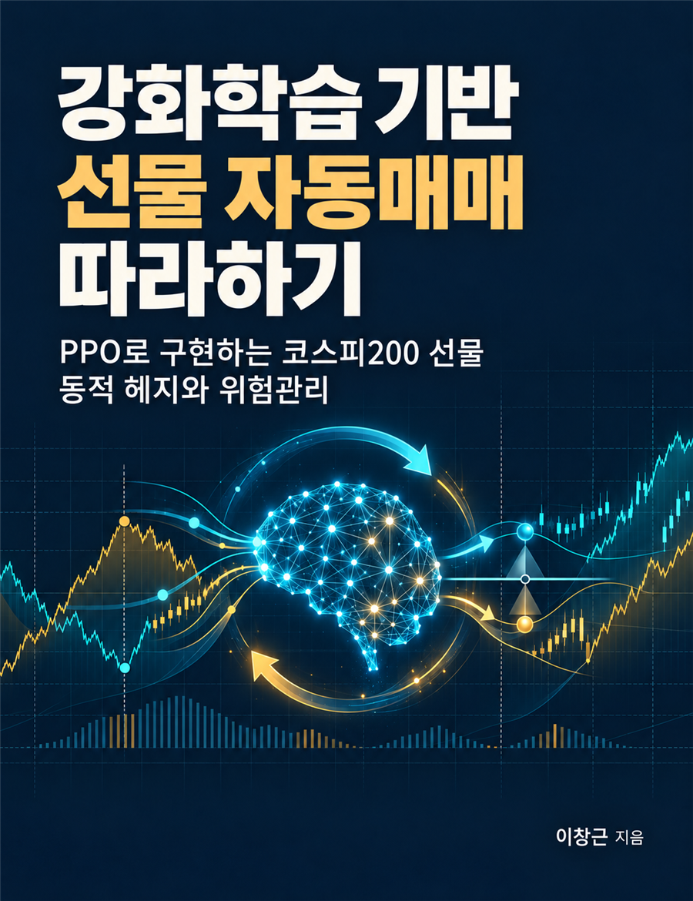

# stock-futures-tutorial

<p align="center">
  <a href="https://wikidocs.net/book/21732"></a>
</p>

위키독스 책 **「강화학습 기반 선물 자동매매 따라하기 — PPO로 구현하는 코스피200 선물 동적 헤지와 위험관리」**의 예제 코드 저장소입니다.

- 책: https://wikidocs.net/book/21732

코스피200 정규선물 1계약 매수 + 미니선물 0~5계약 매도 포지션에서, PPO 강화학습 에이전트가 헤지비율을 조절하도록 학습시키고 그 위험조정 성과를 검증합니다.

> **투자 위험 고지** — 이 저장소의 코드는 교육·연구 목적입니다. 어떠한 수익도 보장하지 않으며, 실제 주문 기능은 포함하지 않습니다. 실제 거래에 따른 판단과 책임은 사용자 본인에게 있습니다.

## 시작하기 (책 03-1)

```bash
git clone https://github.com/ady95/stock-futures-tutorial.git
cd stock-futures-tutorial
python -m venv .venv
.\.venv\Scripts\Activate.ps1        # macOS/Linux: source .venv/bin/activate
python -m pip install -r requirements.txt
python ch03/make_synthetic.py       # API 키 없이 쓸 합성 데이터 생성
```

버전은 저자가 실측한 조합(Python 3.10.18, CPU 전용)으로 고정되어 있습니다.

## 구성

```text
hedgelab/            공용 패키지
  contracts.py       월물 코드(신·구 체계)·만기일·표준 쌍
  kis.py             한국투자증권 Open API 클라이언트 (시세 조회 전용)
  data.py            Parquet 저장·불러오기, 두 월물 정렬
  stats.py           쌍 단위 통계
  synthetic.py       합성 데이터 생성기
  episode.py         에피소드 구성 (정규 m월물 + 근월 미니)
  backtest.py        백테스트 엔진 EpisodeSim, 비용·증거금 모형
  strategies.py      기준선 전략 B0·B1·B1n·B2
  metrics.py         성과 지표 (MDD, Sharpe, CVaR, 손익 분해)
  env.py             CalendarSpreadEnv (Gymnasium)
  rl.py              PPO·MaskablePPO 학습·평가 도우미
  risk.py            독립 위험관리 엔진
  live.py            모의운영 (실제 주문 없음)
configs/             실험 설정 (YAML)
ch02/ ~ ch10/        장별 실습 스크립트
tests/               회계 검증 테스트
```

| 장 | 내용 | 실행 |
|---|---|---|
| 02 | 선물 손익·헤지비율 계산 | `ch02/hedge_simulator.py` |
| 03 | 시세 수집·합성 데이터 | `ch03/collect_real.py`, `ch03/make_synthetic.py` |
| 04 | 백테스트 엔진·기준선 | `ch04/run_baselines.py`, `pytest tests` |
| 05 | 강화학습 환경 | `ch05/check_env.py` |
| 06 | PPO 학습·평가 | `ch06/train_ppo.py`, `ch06/evaluate.py`, `ch06/plot_curves.py` |
| 07 | 위험 페널티·위험관리 엔진 | `ch07/compare_rewards.py` |
| 08 | 실제 데이터 워크포워드 검증 | `ch08/walk_forward.py`, `ch08/report.py`, `ch08/episode_stats.py` |
| 09 | 모의운영 | `ch09/run_paper.py` |
| 10 | 대시보드·백테스트 비교 | `streamlit run ch10/dashboard.py`, `ch10/compare_backtest.py` |

전체 재현 순서는 책의 부록 C를 참고하세요.

## API 키와 데이터

한국투자증권 Open API를 쓰는 실습(3장, 9장)은 `.env.example`을 `.env`로 복사해 모의투자 앱키를 넣습니다. `.env`, 토큰 캐시(`.kis/`), 수집 데이터(`data/`)는 git에 올라가지 않습니다.

원본 시장 데이터는 재배포 조건 때문에 이 저장소에 포함하지 않습니다. 수집 코드로 직접 받거나 합성 데이터를 사용하세요.
